<div align="center">

# 🔐 OAuth Playground

**Test OAuth 2.0 / OpenID Connect apps step by step, right in your browser.**
Authorization code · PKCE · Implicit · Password · Client credentials, with every request, response, token and CORS error laid out.

[](https://github.com/sudovex/oauth-playground/actions/workflows/deploy.yml)


[](LICENSE)

### [🚀 Open the live playground →](https://sudovex.github.io/oauth-playground/)

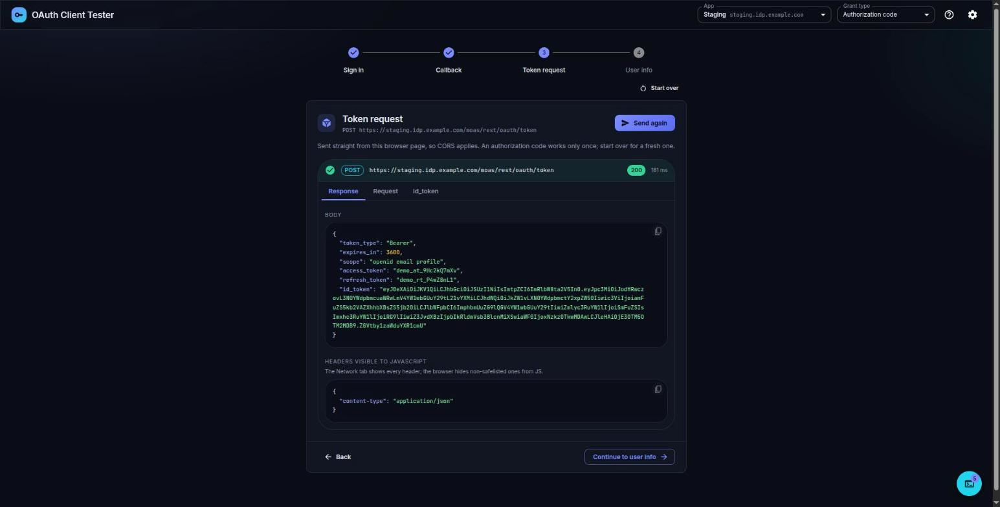

</div>

---

## Contents

- [What is this?](#what-is-this)
- [Features](#features)
- [Quick start](#quick-start)
- [OAuth in 5 minutes](#oauth-in-5-minutes)
- [Grant types explained](#grant-types-explained)
  - [Which one should I use?](#which-one-should-i-use)
  - [Authorization code](#1-authorization-code) · [PKCE](#2-authorization-code--pkce) · [Implicit](#3-implicit) · [Password](#4-password) · [Client credentials](#5-client-credentials)
- [How the playground works](#how-the-playground-works)
- [CORS: the error you will meet](#cors-the-error-you-will-meet)
- [Configuration reference](#configuration-reference)
- [Security notes](#security-notes)
- [Troubleshooting](#troubleshooting)
- [Run locally & deploy](#run-locally--deploy)
- [Project structure](#project-structure)
- [License](#license)

---

## What is this?

When an OAuth login breaks, the hard part is seeing **what actually happened**: which URL the browser was sent to, what came back on the callback, what the token endpoint replied, and why the browser refused to show you the reply.

OAuth Playground walks through a login **one step at a time** and shows everything along the way:

- the authorization redirect and the callback parameters (`code`, `state`, tokens),
- the exact token request (headers + form body) and the full response,
- decoded `id_token` / `access_token` (JWT header and claims),
- the user-info call and a profile card,
- a plain-English explanation when the browser blocks a call because of **CORS**.

It runs entirely in your browser. There is no backend, and your settings never leave your machine except to reach the OAuth server you configured. It's built around [miniOrange](https://www.miniorange.com/) endpoints (cloud or on-premise) via [`mo-oauth-sdk`](https://www.npmjs.com/package/mo-oauth-sdk).

## Features

| | |
|---|---|
| 🧭 **Guided steps** | A stepper that changes with the grant type: *Sign in → Callback → Token request → User info*. Back, forward and **Start over** at any step. |
| 🔑 **5 grant types** | Authorization code, Authorization code + PKCE, Implicit, Password, Client credentials. Switch from the top bar. |
| 🔍 **Full request/response view** | Status, timing, request headers and form body, response headers and body, decoded JWTs, with copy buttons everywhere. |
| 🗂️ **Multiple apps** | Save Staging, Production, a backend service… and switch between them by name and domain. Switching cancels the running flow. |
| 🧱 **CORS diagnosis** | `Failed to fetch` is explained right where it happens, with what to check. |
| 📜 **Logs drawer** | Every step and HTTP call, also in the browser console as `[OAuth Tester]`. |
| 🔒 **Privacy first** | Settings live in your browser's local storage. End-user passwords are never stored or logged. Optional masking of secrets and tokens. |
| ✨ **Polished UI** | Dark theme, first-visit tour, works on mobile. |

<table>
  <tr>
    <td>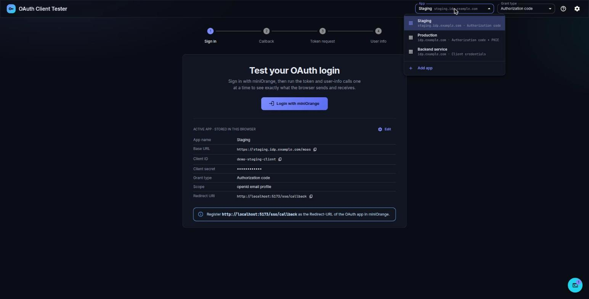</td>
    <td>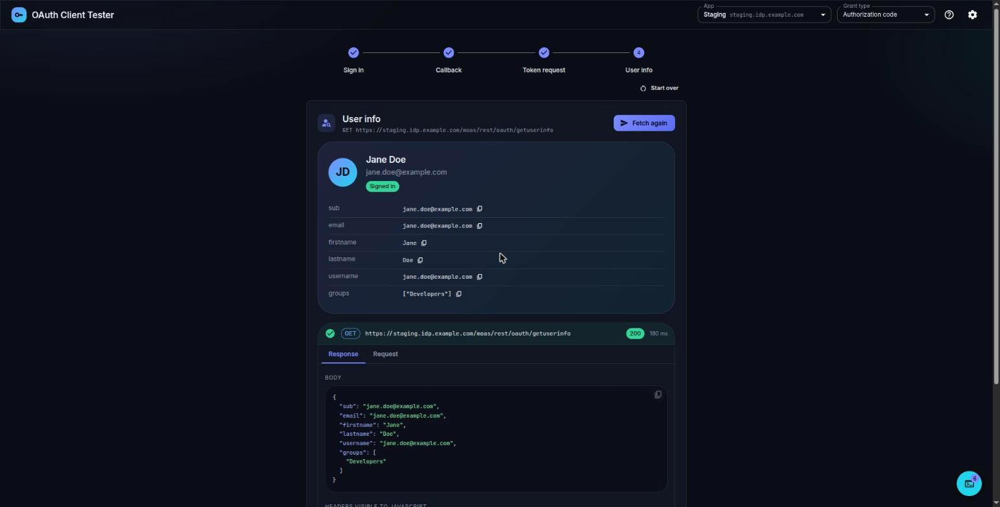</td>
  </tr>
  <tr>
    <td align="center"><sub>Multiple apps, switched from the top bar</sub></td>
    <td align="center"><sub>User info with a profile card and the raw response</sub></td>
  </tr>
  <tr>
    <td>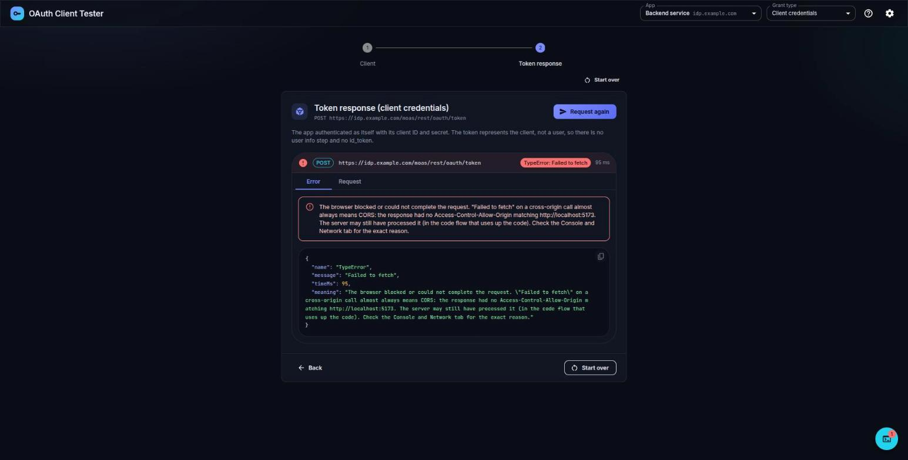</td>
    <td>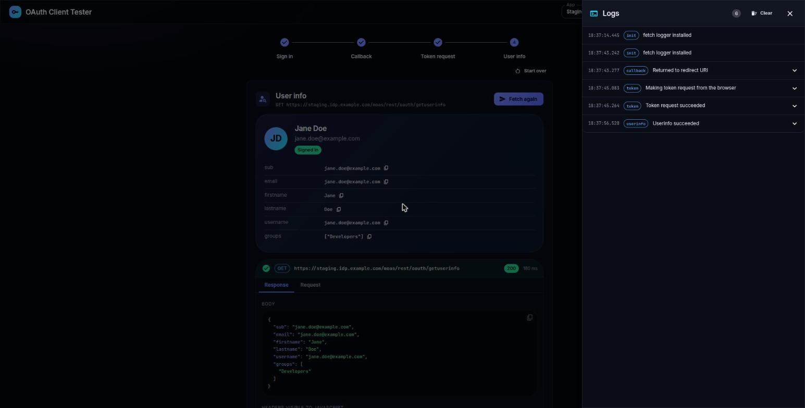</td>
  </tr>
  <tr>
    <td align="center"><sub>CORS failures explained where they happen</sub></td>
    <td align="center"><sub>Logs drawer</sub></td>
  </tr>
</table>

## Quick start

1. **Open** <https://sudovex.github.io/oauth-playground/> (or [run it locally](#run-locally--deploy)).
2. **Add an app**: click ⚙ and enter a name, the base URL (e.g. `https://<your-domain>.xecurify.com/moas`), client ID and client secret.
3. **Register the redirect URL** shown in Settings in your OAuth app:
   ```
   https://sudovex.github.io/oauth-playground/sso/callback
   ```
4. **Pick a grant type** in the top bar and follow the steps. Open the **logs** (bottom-right button) whenever something looks off.

> [!TIP]
> The first visit shows a short tour. Replay it any time with the **?** icon in the top bar.

<p align="center">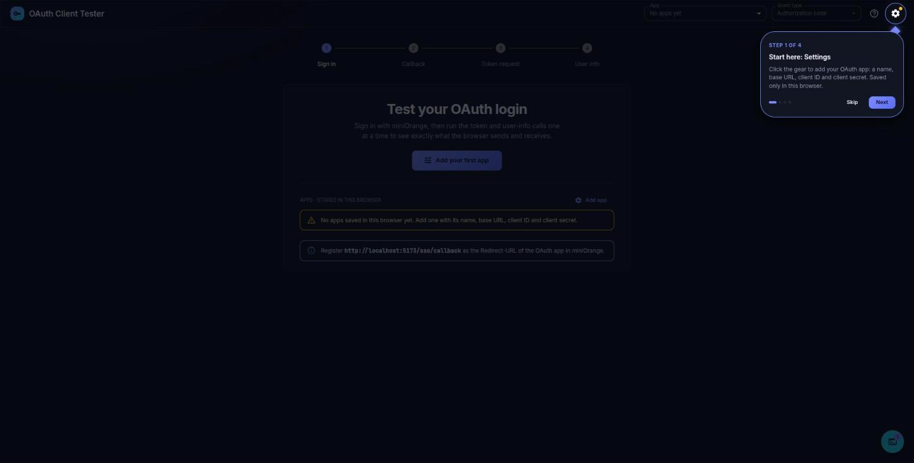</p>

---

## OAuth in 5 minutes

**OAuth 2.0** lets an application get **limited access** to something on a user's behalf **without ever seeing the user's password**. **OpenID Connect (OIDC)** adds a standard way to learn **who the user is**.

Think of a hotel: you show your ID at the front desk (the **authorization server**) once, and get a **key card** (the **access token**) that opens only your room (the **scopes**) for a limited time. The room door (the **resource server**) only checks the card, never your ID.

### The four roles

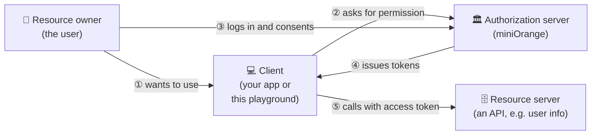

### The pieces you'll see in the playground

| Thing | What it is | Example |
|---|---|---|
| **Client ID** | Public identifier of your app | `aB3dE5…` |
| **Client secret** | Your app's password. Keep it on a server in real apps | `s3cr3t…` |
| **Redirect URI** | Where the authorization server sends the browser back | `…/sso/callback` |
| **Scope** | What you're asking for | `openid email profile` |
| **State** | Random value that protects the callback from forgery (CSRF) | `x7Kp…` |
| **Authorization code** | Short-lived, one-time ticket, swapped for tokens | `?code=1y8xQ…` |
| **Access token** | The key card: sent to APIs as `Authorization: Bearer …` | opaque or JWT |
| **ID token** (OIDC) | A signed JWT saying *who* logged in | `eyJhbGciOi…` |
| **Refresh token** | Gets a new access token without logging in again | opaque |

### What's inside an ID token?

An ID token is a **JWT**: three Base64URL parts separated by dots, `header.payload.signature`. The playground decodes the first two for you:

```json
{
  "header":  { "alg": "RS256", "typ": "JWT", "kid": "f79f…" },
  "payload": {
    "iss": "https://idp.example.com/…",   // who issued it
    "aud": "your-client-id",              // who it's for
    "sub": "jane.doe@example.com",        // the user
    "exp": 1793993600,                    // expiry (Unix time)
    "email": "jane.doe@example.com"
  }
}
```

> [!NOTE]
> Decoding is not verifying. Real apps must check the signature (using the server's JWKS), `iss`, `aud` and `exp`. The playground only decodes so you can read the claims.

---

## Grant types explained

A **grant type** is the recipe a client follows to get a token. They differ in **who is involved** (a user? a browser?) and **how the token is delivered**.

| Grant type | User involved? | Browser redirect? | Needs client secret? | Tokens you get | Status today |
|---|:---:|:---:|:---:|---|---|
| **Authorization code** | ✅ | ✅ | ✅ | access, id, refresh | ✅ Standard for server-side web apps |
| **Authorization code + PKCE** | ✅ | ✅ | ❌ (proof key instead) | access, id, refresh | ✅ Recommended for SPAs & mobile |
| **Implicit** | ✅ | ✅ | ❌ | access and/or id, straight in the redirect | ⚠️ Legacy, avoid for new apps |
| **Password** | ✅ (types password into the app) | ❌ | ✅ | access, id, refresh | ⚠️ Legacy, only for highly trusted apps |
| **Client credentials** | ❌ | ❌ | ✅ | access only | ✅ Standard for machine-to-machine |

### Which one should I use?

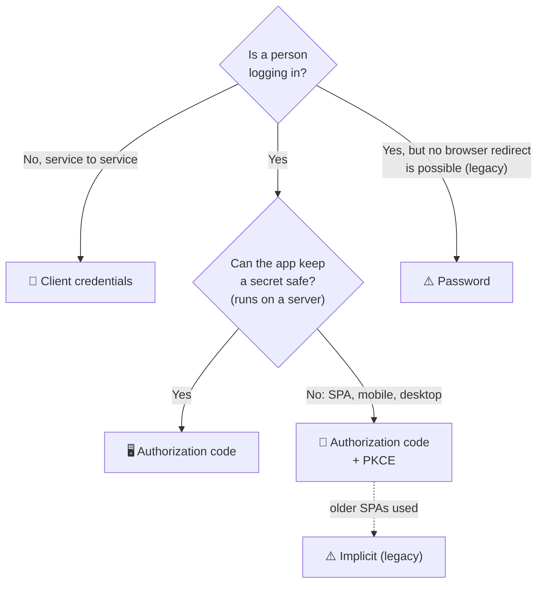

---

### 1. Authorization code

> The classic, most secure flow for apps with a backend. The browser only ever carries a short-lived **code**. The tokens are fetched in a separate call that includes the client secret.

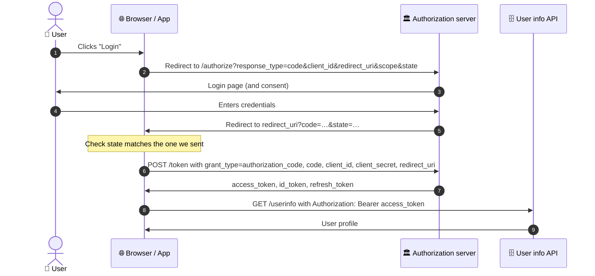

**In the playground:** *Sign in → Callback* (shows `code`, `state` and the state check) → *Token request* (click **Make token request**) → *User info*.

---

### 2. Authorization code + PKCE

> Same as above, but built for apps that **can't keep a secret** (single-page and mobile apps). Before redirecting, the app creates a random **code verifier** and sends only its SHA-256 hash (the **code challenge**). At token time it reveals the verifier, which proves it's the same app that started the login.

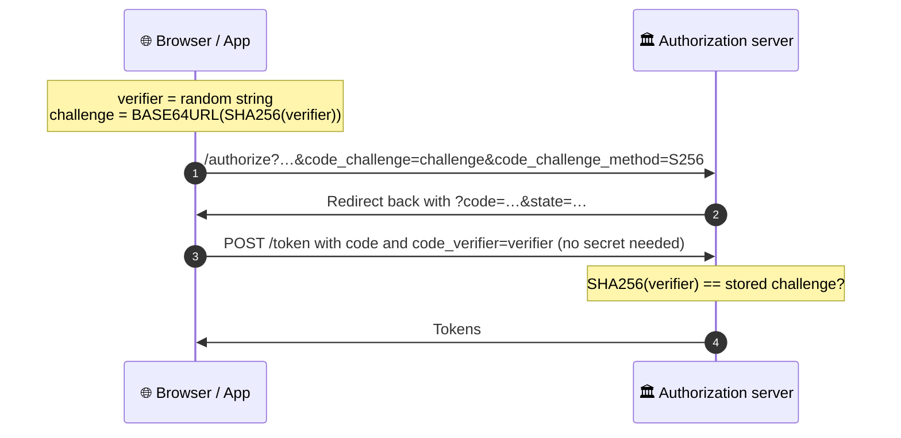

A stolen code is useless without the verifier, which never left the app.

**In the playground:** the Callback step shows the stored `code_verifier` and the re-computed `code_challenge`, so you can check that they match what was sent.

---

### 3. Implicit

> An older shortcut for browser apps: **no token request at all**. The tokens come back directly in the redirect URL. Simple, but tokens end up in browser history and logs, and there's no refresh token. PKCE replaced it.

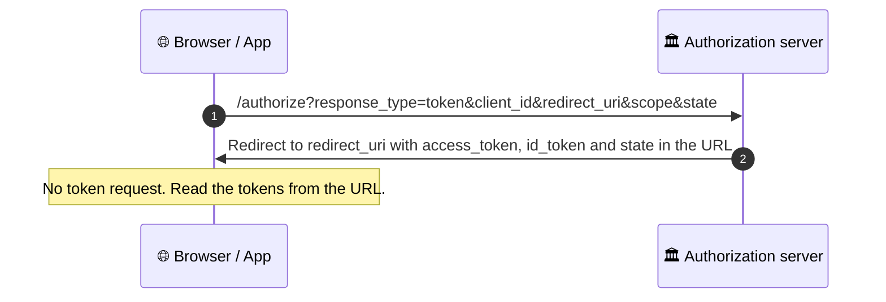

**In the playground:** the step is called *Callback + tokens*. It reads tokens from either the query string (`?access_token=…`, which miniOrange's `/idp/openidsso` uses) or the URL fragment (the standard form), shows where they came from, and decodes the `id_token`.

> [!NOTE]
> miniOrange's `/idp/openidsso` only includes an `access_token` here when the scope has more than just `openid`.

---

### 4. Password

> The user types their username and password **into the app**, which sends them straight to the token endpoint. No redirect, no login page. It's only acceptable for first-party, highly trusted apps, because the app sees the password. It's deprecated in OAuth 2.1.

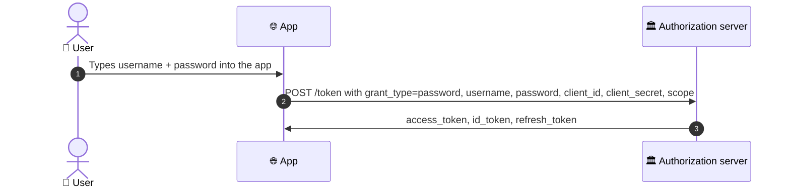

**In the playground:** choose **Password**, and the first step becomes a login form. The password is sent only to the token endpoint and is **always** shown as `********` in the request view, logs and console. It is never stored.

---

### 5. Client credentials

> **No user at all.** The application logs in **as itself** with its client ID and secret, like a service account. Used for machine-to-machine calls: backend jobs, cron tasks, microservices.

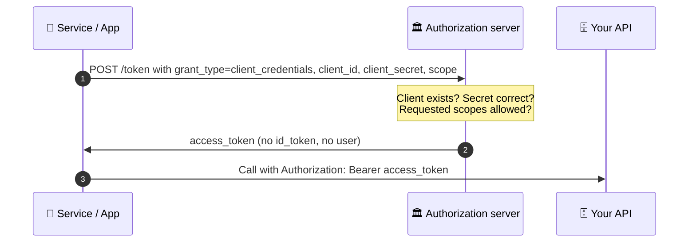

**In the playground:** two steps, *Client → Token response*. There's no user info step, because there's no user. If the access token is a JWT, it's decoded in its own tab.

---

## How the playground works

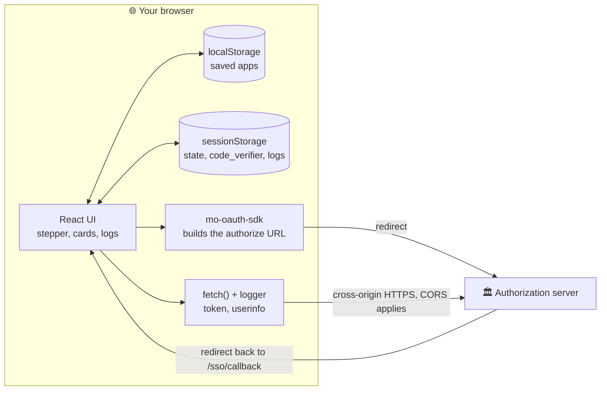

- **No server of its own.** It's a static site (GitHub Pages). All calls go straight from your browser to the OAuth server.
- **Redirect flows** (code, PKCE, implicit) use `mo-oauth-sdk` to build the authorization URL, and come back to `<site>/sso/callback`.
- **Direct flows** (password, client credentials) post to the token endpoint immediately.
- **Every `fetch`** is wrapped by a logger, so requests and responses appear in the logs drawer and the console.
- **Switching app or grant type** cancels in-flight requests, clears pending login state and returns to step 1.

### What is stored where

| Data | Where | How long |
|---|---|---|
| Saved apps (name, base URL, client ID/secret, scope, grant type) | `localStorage` for this site | Until you delete them in Settings or clear site data |
| `state`, `code_verifier` of a pending login | `sessionStorage` | This tab session |
| Logs | `sessionStorage` | This tab session (survive the redirect to the login page and back) |
| End-user password (password grant) | Nowhere | Only kept in memory while sending |

---

## CORS: the error you will meet

Browsers block JavaScript from **reading** a response from another site unless that site explicitly allows it with a header. The token and user-info calls go from the playground's site to your OAuth server, a different site, so the server must allow it.

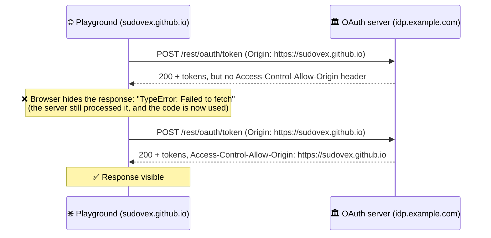

**Fix it on the server side**: allow the playground's **origin** (scheme + host, no path) on the OAuth endpoints. For example, with nginx in front of the server:

```nginx
# http { } block
map $http_origin $cors_origin {
    default "";
    "https://sudovex.github.io" $http_origin;
    "http://localhost:5173"     $http_origin;
}

# server { } block
location ^~ /rest/oauth/ {
    add_header Access-Control-Allow-Origin  $cors_origin always;
    add_header Access-Control-Allow-Methods "GET, POST, OPTIONS" always;
    add_header Access-Control-Allow-Headers "Authorization, Content-Type" always;
    add_header Vary Origin always;
    if ($request_method = OPTIONS) { return 204; }
    proxy_pass http://127.0.0.1:8080;   # your IdP upstream
}
```

> [!TIP]
> Check it without a login:
> `curl -si -X POST https://idp.example.com/rest/oauth/token -H "Origin: https://sudovex.github.io" | grep -i access-control`

---

## Configuration reference

All settings are entered in the **Settings** dialog (⚙). There is no config file.

| Field | Required | Notes |
|---|:---:|---|
| **App name** | ✅ | Shown with the domain in the app switcher |
| **Base URL** | ✅ | Cloud: `https://<domain>.xecurify.com/moas` · On-premise: your server URL |
| **Client ID** | ✅ | From the OAuth app |
| **Client secret** | Code, Password, Client credentials | Optional for PKCE and Implicit |
| **Grant type** | ✅ | Also switchable from the top bar |
| **Scope** | ✅ | Space separated, e.g. `openid email profile` |
| **Broker URI** | | Only when the authorization server brokers an external IdP |
| **Redirect-URL** | (generated) | `<where the app is hosted>/sso/callback`. Register it in your OAuth app |
| **Mask secrets in logs** | | Shortens secrets and tokens in logs (applies to all apps) |

**Endpoints used** (built from the base URL):

| Purpose | Path |
|---|---|
| Authorize | `/idp/openidsso` |
| Token | `/rest/oauth/token` |
| User info | `/rest/oauth/getuserinfo` |
| Logout | `/idp/oidc/logout` |

---

## Security notes

> [!WARNING]
> This is a **testing tool**. Use test or staging credentials.

- The **client secret is stored in plain text** in your browser and sent from the browser. Real browser apps must never hold a secret: use **PKCE** instead, or do the token exchange on a backend.
- **End-user passwords** typed for the password grant are never stored, and are redacted in every view and log.
- Everything stays on your device except the calls to the OAuth server you configured. Delete apps any time from Settings → **Delete app** / **Delete all apps**.

---

## Troubleshooting

| You see | Likely cause | What to do |
|---|---|---|
| `TypeError: Failed to fetch` | **CORS**: the server didn't allow this origin | Add the origin on the server ([see CORS](#cors-the-error-you-will-meet)). Check the browser console and Network tab |
| `redirect_uri mismatch` on the login page | Redirect URL not registered, or a different host or port | Register the exact URL shown in Settings |
| State check: *does not match* | Login started in another tab, or session storage was cleared | Start over and log in again from the same tab |
| `invalid_grant` on the token step | The code was already used or has expired | Codes work once. **Start over** for a fresh one |
| `invalid_client` | Wrong client ID or secret | Fix them in Settings |
| `invalid_scope` (client credentials) | None of the requested scopes are allowed for the app | Use scopes the OAuth app permits |
| No `access_token` with implicit | Scope is only `openid` | Add `email profile` to the scope |

---

## Run locally & deploy

```bash
git clone https://github.com/sudovex/oauth-playground.git
cd oauth-playground
npm install
npm run dev            # http://localhost:5173  → redirect URL http://localhost:5173/sso/callback
```

| Command | What it does |
|---|---|
| `npm run dev` | Dev server on port 5173 (ngrok hosts allowed) |
| `npm run build` | Production build into `dist/` (also writes `404.html` so `/sso/callback` works on GitHub Pages) |
| `npm run preview` | Serve the production build locally |

**Deploy:** every push to `main` builds and publishes to GitHub Pages via [`.github/workflows/deploy.yml`](.github/workflows/deploy.yml) (repo **Settings → Pages → Source: GitHub Actions**). For a custom domain, set `BASE_PATH` in the workflow to `/`.

## Project structure

```
oauth-playground/
├── .github/workflows/deploy.yml   # Build & publish to GitHub Pages
├── docs/screenshots/              # Images used in this README
├── index.html
├── vite.config.js                 # Base path for Pages, allowed dev hosts
└── src/
    ├── main.jsx                   # Theme provider, installs the fetch logger
    ├── App.jsx                    # Stepper, flows for each grant type, top bar
    ├── settings.js                # Saved apps store (localStorage), grant type helpers
    ├── oauth.js                   # Endpoints + mo-oauth-sdk config
    ├── logger.js                  # Logs (sessionStorage), masking and password redaction
    ├── fetchLogger.js             # Wraps fetch to log every request/response
    ├── theme.js                   # Dark MUI theme
    └── components/
        ├── SettingsDialog.jsx     # Add / edit / delete apps
        ├── CallResult.jsx         # Request/response/JWT viewer
        ├── CodeBlock.jsx          # Highlighted JSON with copy
        ├── LogPanel.jsx           # Logs drawer
        └── Tour.jsx               # First-visit coach marks
```

**Built with:** [React](https://react.dev) · [Vite](https://vitejs.dev) · [MUI](https://mui.com) · [mo-oauth-sdk](https://www.npmjs.com/package/mo-oauth-sdk)

## License

[MIT](LICENSE) © 2026 sudovex. Free to use, modify and share.

---

<div align="center">
<sub>Made for anyone who has ever stared at <code>Failed to fetch</code> and wondered what OAuth was doing.</sub>
</div>
